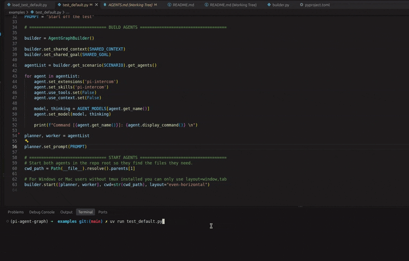

# pi-agent-graph

A Python library for building and launching multi-agent pi workflows. Define a
roster of agents, bind each one to a saved `pi-cli` config or build its command
in Python, then start them in their own terminals where they coordinate over
`pi-intercom`. The full design lives in [SPEC.md](./SPEC.md).

<p align="center">
  
</p>

## Install

This project is managed with [uv](https://docs.astral.sh/uv/):

```bash
git clone https://github.com/LaishGlenberg/pi-agent-graph.git
cd pi-agent-graph
uv sync
```

## Development

```bash
uv sync                 # install runtime + dev dependencies
uv run pytest           # run the test suite
uv run pi-agent-graph   # console entry point (prints help in v1)
```

## Quickstart

```python
from pathlib import Path

from pi_agent_graph import AgentGraphBuilder

builder = AgentGraphBuilder()

builder.set_shared_context("always use pi-intercom when you finish your message, don't assume other agents can see your output")
builder.set_shared_goal("write a simple hello world program as a smoke test for agentic intercom communication")

agentList = builder.get_scenario("checklist_iteration").get_agents()

# builder shares the same methods as the agent class, will apply to ALL agents
for agent in agentList:
    agent.set_extensions('pi-intercom')
    agent.set_skills('pi-intercom')
    agent.use_tools.set(False)
    agent.use_context.set(False)
    agent.set_model("deepseek/deepseek-flash", "low")
    print(f"Command [{agent.get_name()}]: {agent.display_command()} \n")

planner, worker = agentList
planner.set_prompt("begin working on the plan")

cwd_path = Path(__file__).resolve().parents[1]

# For Windows or Mac users without tmux installed you can only use layout=window,tab or omit it entirely
builder.start([planner, worker], cwd=str(cwd_path), layout="even-horizontal")
```

## Python API

`AgentGraphBuilder` builds `Agent`s and launches them. The resource and model
setters below exist on both classes: on a builder they set defaults, on an agent
they override that agent. Both replace the matching flags from a saved `pi-cli`
command, so precedence is agent > builder > config.

### Shared by builder and agent

| Method | Effect |
| --- | --- |
| `set_model(model, thinking)` | Model; `thinking` appends `:thinking`. |
| `set_extensions(*names, agent_dir)` | Extensions. |
| `set_skills(*names, agent_dir)` | Skills. |
| `set_tools(*names)` | Built-in keep-list. |
| `set_exclude_tools(*names)` | Tool exclusions. |
| `use_extensions` | Switch; `-ne` when false. |
| `use_skills` | Switch; `-ns` when false. |
| `use_tools` | Switch; `-nbt` when false. |
| `use_context` | Switch; `-nc` when false. |

`Switch.set(bool)` flips a family on/off, `.get()` reads it, and `.explicit`
reports whether Python set it.

### Builder only

| Method | Effect |
| --- | --- |
| `set_shared_goal(text)` | Shared goal for every rendered prompt. |
| `set_shared_context(text)` | Shared context for every rendered prompt. |
| `list_scenarios()` | Scenario keys. |
| `get_scenario(key)` | ScenarioBuilder for `key`; `.get_agents()` / `.get(role)`. |
| `load_saved(identifier, directory, path)` | Load a fixture. |
| `save_fixture(identifier, scenario, roles, prompts, names, directory, path)` | Save the current goal/context as a fixture. |
| `get_agent_loader(path)` | `ConfigLoader` for saved commands. |
| `start(agents, backend, options, cwd, layout)` | Launch a roster. |
| `start_dry(agents)` | Print the commands without launching. |
| `display_command(agents)` | Pi-cli-style command lines as one string. |
| `save_bash(agents, path, cwd)` | Write a runnable `.sh` / `.cmd`. |

### Agent only

| Method | Effect |
| --- | --- |
| `set_command(argv)` | Resolved `pi` command; managed flags move into fields. |
| `set_option(flag, value)` | Any flag, replacing an existing occurrence. |
| `set_name(name)` | Display name. |
| `set_session_dir(path)` | Session directory. |
| `set_system_prompt(text)` | System prompt. |
| `set_prompt(text)` | Starting prompt. |
| `set_cwd(path)` / `set_dir(path)` | Working directory; `set_dir` is an alias. |
| `get_name()` | Display name, defaulting to the role. |
| `build_argv()` | Assembled argv. |
| `display_command()` | Readable command line. |

### `launch`

```python
from pi_agent_graph import launch
result = launch(agents, backend="print")   # print | bash | terminal
```

`LaunchOptions` holds `backend`, `stagger`, `session_dir`, `run_id`, `cwd`,
`bash_path`, `platform`, and `layout` (`"window"` default, `"tab"`, or a tmux
layout — Linux only). `LaunchResult` records `run_id`, `backend`, `commands`,
`agents`, `pids`, and `path`.

### `ConfigLoader`

`ConfigLoader()` expands a saved `pi-cli` agent name into argv via
`pi-cli --dry-run`. `list()` returns names and `get(name)` the full argv.

## Built-in scenarios

Scenarios are defined in code (`scenarios.py`) and are meant to be extended.

| Scenario | Roles | What it does |
| --- | --- | --- |
| `checklist_iteration` | `planner`, `worker` | Planner writes a grouped checklist; the worker ticks off one group at a time; the planner validates (tests / lint / typecheck) and commits after each group, then hands over the next. |
| `subagent_scouting` | `worker`, `scout` | The worker asks a fast `scout` to gather codebase context, keeping the worker's own context window clean. |
| `scout_worker_planner` | `planner`, `worker`, `scout` | The planner orchestrates, the worker edits, the scout gathers — so the planner's context stays small. |
| `testing` | `planner`, `worker` | Disposable roster for smoke tests; the agents only greet and echo over intercom. |

Each role has a seed description that is combined with your shared goal and
shared context into the agent's system prompt.

## Fixtures and pi-cli configs

```python
builder.load_saved("my_demo", directory="fixtures")   # JSON snapshot of goal/context + role configs
builder.save_fixture("my_demo", "checklist_iteration", roles={"planner": "plannerv2", "worker": "workerv3"})
```

`fixture_path` / `load_fixture` / `save_fixture` are the low-level helpers; bad or missing files raise `FixtureFormatError` / `FixtureNotFoundError`. `ConfigLoader` expands a saved `pi-cli` agent into argv via `pi-cli --dry-run`, pinning `PI_CLI_CONFIG` so your config is never touched.

## Platform support

`pi-agent-graph` targets Windows, macOS, and Linux.

| Platform | `terminal` backend |
| --- | --- |
| Windows | A temp `.cmd` is opened with `cmd /k`, via Windows Terminal (`wt`) when present, else `cmd /c start`. This keeps `wt` from splitting system prompts on `;`. |
| macOS | Terminal.app via `osascript`. |
| Linux | `tmux` when inside a session, else `wt` → `gnome-terminal` → `konsole` → `xfce4-terminal` → `kitty` → `alacritty` → `xterm`. |


`bash` emits a `.sh` script on POSIX and a `.cmd` script on Windows.
